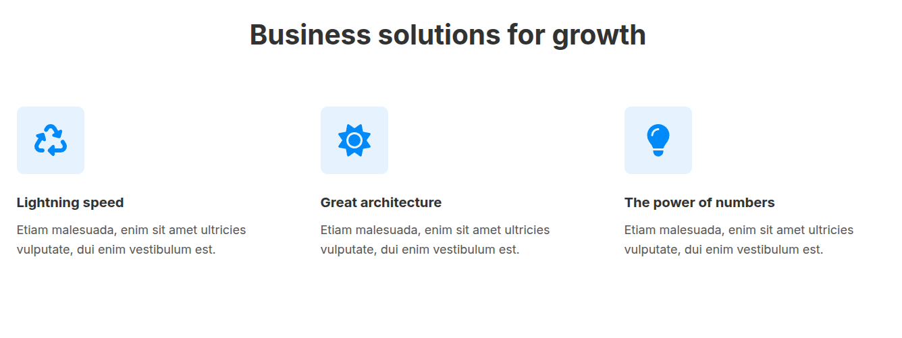
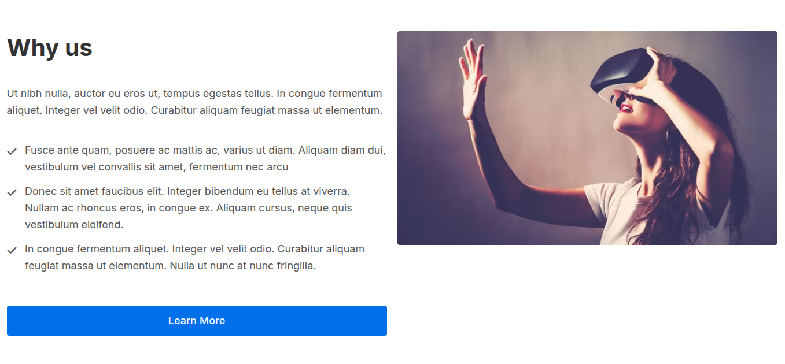
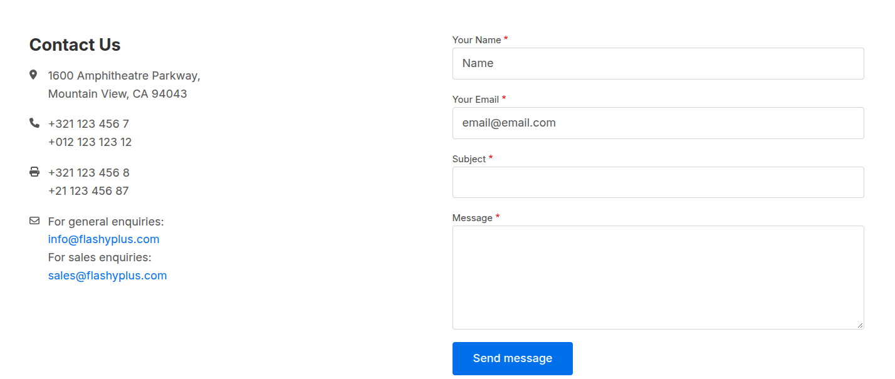

# Create a Page

This guide walks you through building a Canvas page using Basecore components.

## Step 1: Create a new page

To create a new Canvas page, navigate to `admin/content/pages` and click the **Add Page** button at the top right corner.

You can add any component available in the Component Library by dragging and dropping it into the page content section.

## Step 2: Create a Hero

Start by adding a **Section** component from the component library. Set the **Column Layout** option to `100` to create a single-column section.

In the **Add content** placeholder, add a **Hero** component. The Hero component comes with a predefined two-column layout with equal-width columns. You can customize the layout by choosing from the available column width options and positioning the image on either the left or right side. You can also configure the button actions and link destinations according to your preferences.

## Step 3: Create the Business solutions for growth stack

Start by adding a **Section** component from the component library. Set the **Column Layout** option to `100` to create a single-column section.

In the **Add content** placeholder, add a **Text** component and set the **Heading Level** to `H2` to use it as the section title.

Below the Text component, add a **Grid Layout** component. Configure the layout as follows:

- Set **Column Layout Extra Large** to `33-33-33`.
- Set **Column Layout Large** to `33-33-33`.

This creates a three-column layout for screen widths of 992 px and above.

Next, set **Column Layout Medium** to `100` so the layout collapses into a single column on screens smaller than 992 px.

Within the **Add component** placeholders of the Grid Layout, add three **Icon Feature** components. For each component, configure the **Icon Name**, **Title**, and **Body** to match your content.

Save your changes and preview the page to see the completed layout.

## Step 4: Create the Why us stack

Start by adding a new **Section** component from the component library. Set the **Column Layout** option to `50-50` to create two equal-width columns.

In the left column, add a **Text** component and use it as the section title. Set the **Heading Level** to `H2` and adjust the **Margin** options as needed. Below the Text component, add a **Rich Text** component for the main content.

Next, add a **Bootstrap Grid** component below the Rich Text component, and place a **Bootstrap Grid Column** component inside it. Within the **Add content** placeholder of the Bootstrap Grid Column, add a **Button** component.

In the right column of the Section component, add an **Image** component. Select or upload an image from the media library and configure the **Aspect Ratio** according to your preferences.

Save your changes and preview the page to see the completed layout.

## Step 5: Create the Logo links stack

Start by adding a **Section** component from the component library. Set the **Column Layout** option to `100` to create a single-column section.

In the **Add content** placeholder, add a **Grid Layout** component. Configure the layout as follows:

- Set **Column Layout Extra Large** to `25-25-25-25`.
- Set **Column Layout Large** to `50-50`.

This creates a four-column layout for screen widths of 1200 px and above, and a two-column layout for screen widths of 992 px to 1200 px.

Next, set **Column Layout Medium** to `100` so the layout collapses into a single column on screens smaller than 992 px.

Within the **Add component** placeholders of the Grid Layout, add four **Logo Links** components. For each component, configure the **Image**, **Link URL**, and **Logo size** to match your content.

Save your changes and preview the page to see the completed layout.

## Step 6: Create the Contact us stack

Start by adding a **Section** component from the component library. Set the **Column Layout** option to `50-50` to create a two-column section.

In the first **Add content** placeholder, add a **Text** component and set the **Heading Level** to `H3` to use it as the section title. Below the Text component, add a **Rich Text** component. Locate the **Description** field and click the **More options** button to select the source editing option. This allows you to enter your custom HTML markup.

In the remaining **Add content** placeholder, add a **Webform** component and select the **Contact** form.

Save your changes and preview the page to see the completed layout.

## Reference Guide

An overview of the layout components available in the Component Library.

### Section

The Section implements the behavior of the Bootstrap container and the Bootstrap columns. It is suggested to start building your page with this component as your base component. You can choose among a variety of column layouts and drag and drop other components from the component library.

### Grid Layout

The **Grid Layout** is a single grid container that hosts the child elements directly. You can choose from the predefined responsive behavior and add additional components from the component library.

### Bootstrap Grid and Bootstrap Grid Column

**Bootstrap Grid** and **Bootstrap Grid Column** are two components that work together to accomplish the layout behavior.

First, add the **Bootstrap Grid** component, and inside it, add a **Bootstrap Grid Column** component. Combined, these two components give you full CSS control over the row and over each column's properties, using the Bootstrap CSS Grid.
