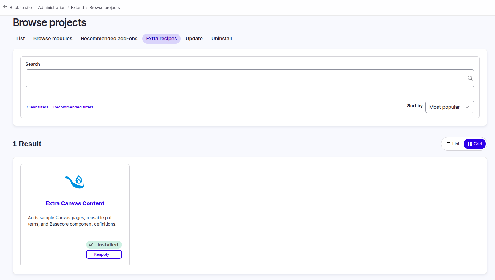

# Drupal CMS + Basecore

## Install Drupal CMS

Install Drupal CMS following the procedure described in the Drupal CMS User Guide:

- [Drupal CMS User Guide](https://project.pages.drupalcode.org/drupal_cms/)

## Install the Basecore theme

Download and install the Basecore theme:

- [Basecore theme](https://www.drupal.org/project/basecore)

## Install required modules

Install and enable the additional modules required for the Basecore Canvas components to function as designed:

| Module | Link |
| --- | --- |
| Metatag | [drupal.org/project/metatag](https://www.drupal.org/project/metatag) |
| Contact | [drupal.org/project/contact](https://www.drupal.org/project/contact) |
| Canvas Full HTML | [drupal.org/project/canvas_full_html](https://www.drupal.org/project/canvas_full_html) |
| Webform | [drupal.org/project/webform](https://www.drupal.org/project/webform) |

## Enable the theme

Install and enable the theme, then clear the Drupal caches to ensure that all theme components are available on the website.

## Add demo content

### Download and install the Project Browser Extra Recipes

Download the module using Composer:

- [Project Browser Extra Recipes](https://www.drupal.org/project/extra_content_canvas_basecore)

```bash
composer require 'drupal/extra_project_browser:^1.0'
```

### Install the Project Browser Extra Recipes

Download the recipe using Composer:

- [Extra Content Canvas Basecore](https://www.drupal.org/project/extra_content_canvas_basecore)

```bash
composer require drupal/extra_content_canvas_basecore
```

Navigate to `admin/modules/browse/extra_recipes` and enable the extra recipes to display the demo content.

